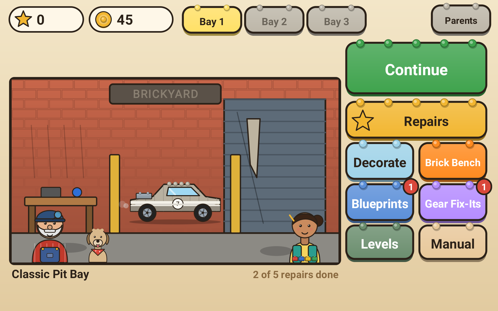
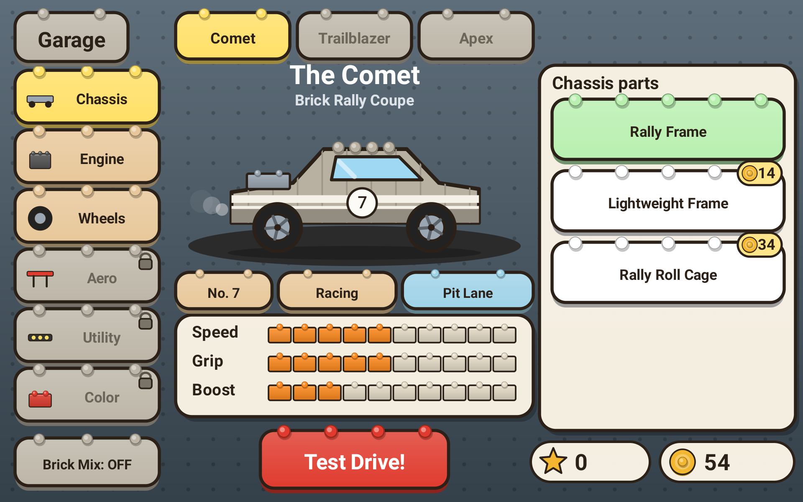
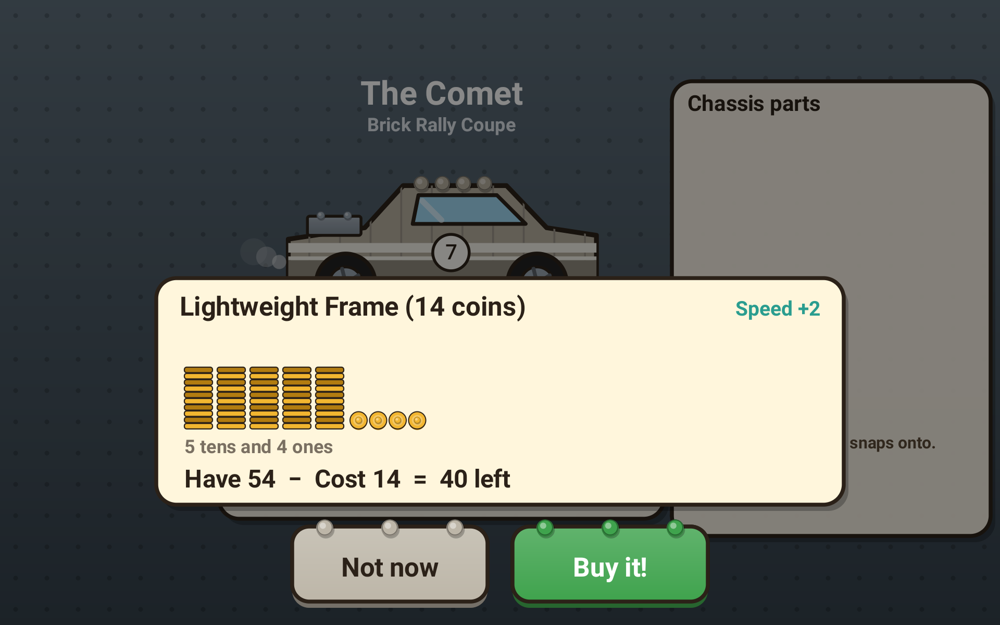
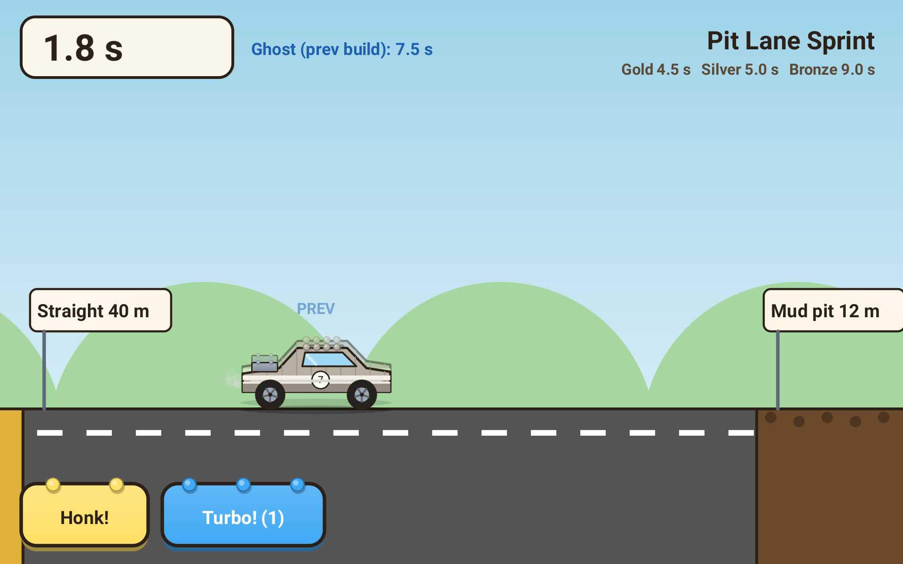
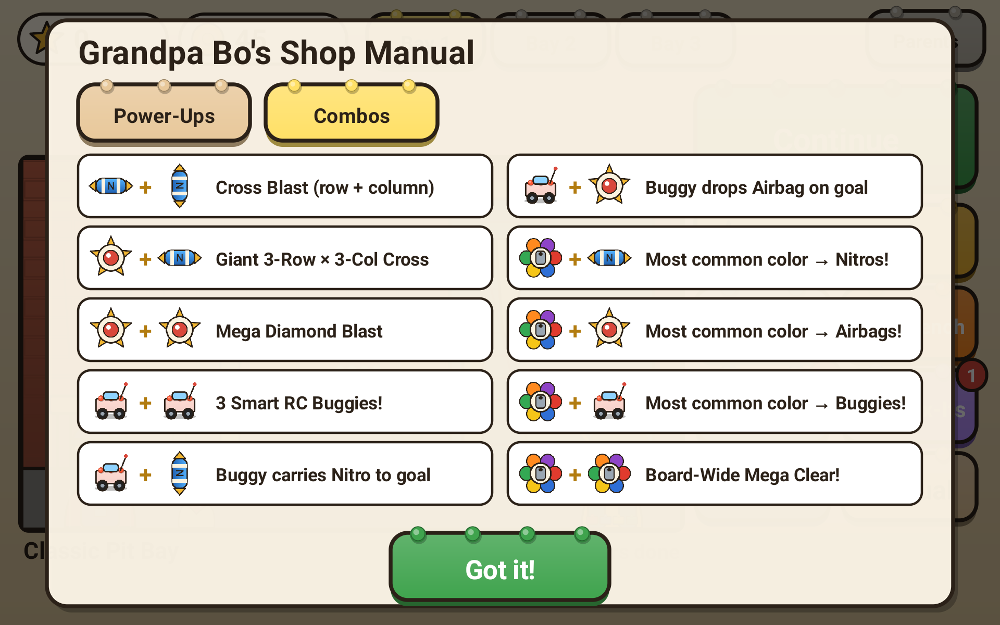
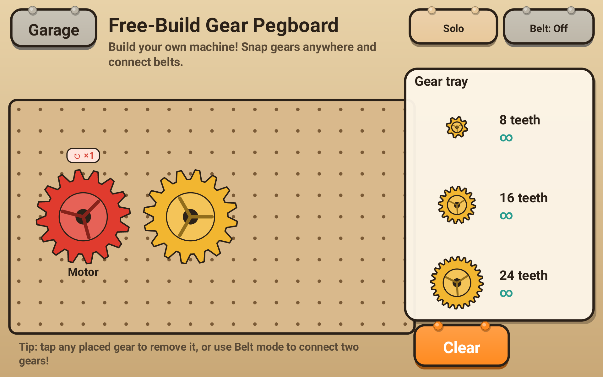

# Brickyard Garage

An offline match-3 and modular brick-car building game for Android and Amazon Fire tablets, designed for a young builder who loves cars and brick engineering.

Solve puzzle boards to earn stars, restore Grandpa Bo's three garage bays, customize three modular brick vehicles, and race them on the Test Track. Includes solver-proven Blueprint puzzles with visible refill queues, interlocking gear-train puzzles with a Free-Build Pegboard, an illustrated Shop Manual, and a **Together** pass-and-play mode for playing with a parent or grandparent.

- **Latest release (`v1.1.0`, `versionCode 2`):** download from [GitHub Releases](https://github.com/ghoshs89/brickyard_garage/releases) or grab `dist/BrickyardGarage.apk`.
- **Install & Fire tablet Kids profile guide:** see [INSTALL.md](INSTALL.md).
- **Zero permissions:** no internet, accounts, ads, purchases, lives, or level timers.
- **Docs:** [Plan](docs/PLAN.md) · [Roadmap](docs/ROADMAP.md) · [Dev Log](docs/DEVLOG.md) · [Latest Verified Handoff](docs/HANDOFF.md).

## Highlights

- **45 bot-tuned story levels** across 3 garage bays (*Classic Pit Bay*, *Off-Road & Rescue Rig Bay*, *Aero Prototype Lab*), with shaped boards, steel bulkhead walls, drop chutes (portals), assembly-line conveyors, checkered track baseplates, stud crates, wheel clamps, oil spills, rust plates, and rare car parts.
- **3 modular brick vehicles** (*The Comet*, *The Trailblazer*, *The Apex*) with 54 parts, **Cross-Fit Brick Mix** mode (snap owned parts across cars), custom racing numbers (`1`–`99`), and brick stripe decals.
- **Interactive Test Track:** drive any car on all 3 tracks (*Pit Lane Sprint*, *Mud Mountain*, *Wind Tunnel Strip*), race side-by-side against a translucent **Ghost Car** of your previous build, fire **Turbo!** flame bursts, and honk the horn.
- **12 solver-proven Blueprint Puzzles** with visible column refill queues, **1-move Undo**, and an on-device exact solver hint.
- **9 Gear Fix-Its + Free-Build Gear Pegboard:** physically interlocking gear teeth, live direction/speed badges (`↻ ×1`, `↺ ×2`), green mesh-peg highlights while dragging, and an open sandbox with unlimited gears and straight/crossed belts.
- **Safe-failure & mental-math design:** unlimited instant retries, "Closest-Yet" progress ghost, process-focused praise (including Together-mode **Team Combo** callouts), an illustrated **Shop Manual** for power-ups and all 10 combos, a **Bay Level Picker** for replaying favorites, and a **Workshop Ledger** with exact 10-coin stacks (`Have 54 − Cost 14 = 40 left`).
- **Parent Settings (multiplication + 4-digit PIN gate):** separate sound/music toggles, customizable player & Together-mode partner names, persistent **Shop Closing Time** (finishes the current level before Grandpa Bo closes the shop), and backup export/import.

## Screenshots (`v1.1`)

| Garage Hub | Brick Bench | Workshop Ledger |
|---|---|---|
|  |  |  |

| Test Track (Ghost Car & Turbo) | Shop Manual (Combos) | Free-Build Gear Pegboard |
|---|---|---|
|  |  |  |

## Build

```bash
export JAVA_HOME=/opt/homebrew/opt/openjdk@17
./gradlew :engine:test          # engine unit tests
./gradlew verifyAllContent      # full content & difficulty gate (~35 s)
./gradlew :app:distApk          # signed release APK -> dist/BrickyardGarage.apk (runs gate first)
```

## Content tools

```bash
python3 scripts/gen/levels.py                     # story levels + campaign (edit the script, not the JSON)
python3 scripts/gen/garage.py                     # bays, repairs, fixtures, vehicles, parts, tracks
python3 scripts/gen/gears.py                      # gear puzzles
./gradlew :tools:run --args="tune content"        # set move limits from 600 bot runs per level
./gradlew :tools:run --args="forge content"       # search for solver-proven Blueprints
./gradlew :tools:run --args="gears content"       # prove gear puzzles, record witnesses
./gradlew :tools:run --args="trace content b1-08" # watch the bot play a level
```

## Emulator test hook

```bash
adb shell am start -n com.brickyard.garage/com.brickyard.app.MainActivity \
  --ez autopilot true --ei autopilotLevels 5 --ef autopilotSpeed 6
```

Plays hint moves, repairs, retries, and skips conversations, logging to logcat tag `BrickyardAuto`. Reachable only via an `adb` intent extra.
