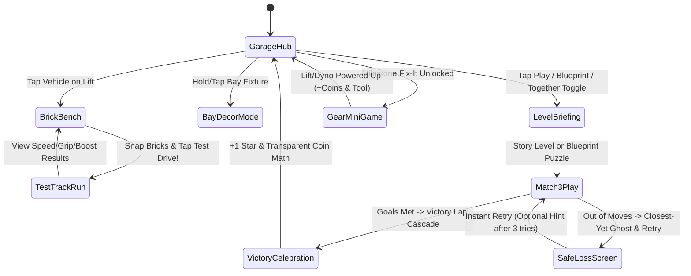

# Brickyard Garage: Homescapes × LEGO Technic & Cars

## Goal Description

Build **`Brickyard Garage`** (`BrickyardGarage.apk`), a 100% offline, ad-free, timer-free Android/Fire OS puzzle-and-building game tailored for a young player who lives and breathes **cars and LEGOs**, benefits from **safe-failure design**, and plays alongside grandparents.

While ChatGPT's *Lantern House* gave a clean baseline APK spec and Claude's *Sprocket Street Garage* rightly pivoted to safe failure, transparent coin math, deterministic puzzles, grandparent pass-and-play, and automated solver checks, **three major gaps remain across both plans**:

1. **Neither plan includes LEGOs—or interactive cars.** Claude reskinned *Lantern House* into a static vintage garage where stars swap flat room furniture. For a kid obsessed with LEGOs and cars, tapping "Rug A / B / C" misses the magic. In *Brickyard Garage*, renovating three garage bays simultaneously unlocks **snap-fit LEGO-style car modules** (chassis, engines, wheels, spoilers, light bars, brick liveries) across **three custom vehicles** with visible stats (**Speed, Grip, Boost**) that the player can test-drive on a physics ramp/track.
2. **Key Playrix *Homescapes* mechanics (per Playrix's official Help Center) are missing.** Flat 8×8 boards get repetitive fast. Authentic *Homescapes* depth comes from **shaped boards with cutouts, internal Walls, Portals, shifting Conveyor Belts, Generators, Carpet-spreading ("Racetrack Baseplates"), tap-in-place power-ups, earned non-turn Mechanic Tools (Wrench = Hammer, Claw = Glove), and end-of-level Victory Lap cascades**, plus **Playrix-style Mini-Games** reimagined here as **LEGO Technic Gear-Train puzzles**.
3. **Claude's Amazon Kids installation & screen-time plan will fail on real Fire OS hardware.** Sideloaded APKs installed on an adult Fire profile **never appear** in *Amazon Parent Dashboard → Add Content → Apps* (which filters strictly to Amazon Appstore entitlements) and are **not tracked** by Amazon Kids screen-time limits. This plan fixes both delivery and session boundaries.

---

## User Review Required

> [!WARNING]
> **Critical Fix to Amazon Kids Delivery & Screen Time on Fire Tablets**
> Claude's plan assumes sideloading via *Unknown Sources* on the parent profile lets you share the game via *Amazon Parent Dashboard → Add Content* and rely on Amazon Kids daily limits. On Fire OS, **sideloaded APKs are invisible to Parent Dashboard** and bypass Kids timers. We solve this with a **two-track delivery strategy**:
> 1. **Recommended Native Kids Path (Free Amazon "Live App Testing"):** Registering a free (\$0) Amazon Developer account and uploading our signed APK to a private **Live App Testing (LAT)** invite for your household email delivers the app *through the Amazon Appstore*. It then natively appears in **Parent Dashboard → Add Content → Apps** and obeys **Amazon Kids daily time limits**—with zero public listing.
> 2. **Instant USB / Offline Fallback + Built-in "Shop Curfew":** A helper script (`scripts/install_fire_child.sh`) uses `adb` multi-user commands (`cmd package install-existing --user <child_id>`) for instant cable installs during testing, paired with an optional PIN-locked **"Garage Closing Time"** cap inside Parent Settings (e.g., max levels or minutes per session) in case you run outside LAT.

> [!IMPORTANT]
> **Upgrading Static Room Décor to Modular Brick Vehicles + Workshop Bays**
> Instead of spending stars only on static room props, each of the **3 Garage Bays** pairs bay restoration with building a **playable modular brick vehicle**:
> - **Bay 1 — Classic Pit Bay:** Restore Grandpa Bo's pit bay & build **"The Comet"** (Brick Rally Coupe).
> - **Bay 2 — Off-Road & Rescue Rig Bay:** Restore the heavy lift bay & build **"The Trailblazer"** (4×4 Off-Road Brick Crawler).
> - **Bay 3 — Aero Prototype Lab:** Restore the wind-tunnel bay & build **"The Apex"** (Hypercar Prototype).
>
> Coins buy **interchangeable brick car parts** (engines, tires, wings, nose cones, brick color packs) AND **bay equipment**, all previewed with explicit mental-math receipts (`Have 74 − Cost 45 = 29 left`) and testable on the **Test Track**!

> [!NOTE]
> **Keystore Storage Outside Repo**
> Release signing keys will be generated once at `~/.android-keys/brickyard-garage.jks` (with credentials in `~/.gradle/gradle.properties`, never committed to git) so every future APK update installs cleanly over the player's saved progress (`adb install -r` or LAT update).

---

## Open Questions

> [!IMPORTANT]
> **Decisions to Confirm Before Implementation**
> 1. **Fire Tablet Details:** Do you happen to know which Fire tablet model / Fire OS version the player uses (e.g., Fire 7 / HD 8 / HD 10, roughly what year)? *(No worries if unknown—keeping `minSdk 22` covers Fire OS 5 through Fire OS 8).*
> 2. **Delivery Preference:** Would you like `INSTALL.md` and the build pipeline set up for **both** free Amazon Live App Testing (native Kids carousel + native time limits) **and** local USB ADB + in-app PIN session limit?
> 3. **Co-op & Story Names:** Should Together Mode pre-fill default player and grandparent names (editable anytime in Settings, with presets for Baba/Ma/Dadu/Didun/etc.)? And do you like **Grandpa Bo, Juno, and Sprocket (the part-stealing pup)** in ***Brickyard Garage***, or would you like the player himself to be the named Junior Chief Engineer in the story?
> 4. **Content Scope for v1:** I propose **45 Story Levels** (15 per bay) + **12 Solver-Proven Blueprint Puzzles** + **9 Technic Gear Mini-Games** + an unlockable **Endless "Track Day" Generator** after completing the story so he never hits a dead end. Does that scope feel right?

---

## Proposed Changes

### System Architecture Overview

```mermaid
flowchart LR
    subgraph BuildTime["Build & Verification (:tools - JVM)"]
        Schema["Level & Blueprint Validator"]
        Solver["IDDFS Exact Move Solver"]
        Bot["Monte Carlo Tactical Bot (500+ runs/lvl)"]
        GearCheck["Technic Gear-Train Graph Verifier"]
        Synth["Offline WAV/OGG Audio Synthesizer"]
    end

    subgraph CoreEngine["Pure Java Simulation (:engine - Zero Android Deps)"]
        Board["Shaped 8x8 Grid, Walls, Portals, Conveyors"]
        Match["Priority Matcher & Combo Resolver"]
        Tools["Earned Mechanic Boosters (Wrench, Claw, Sweep)"]
        GearSim["Gear Ratio & Torque Direction Solver"]
        CarStats["Modular Brick Car Spec & Track Physics"]
        SaveModel["Deterministic JSON State & Atomic Save Schema"]
    end

    subgraph AndroidApp["Fire Tablet App (:app - minSdk 22)"]
        BoardView["60fps Canvas Match-3 Board & Particle FX"]
        BrickRenderer["Procedural LEGO Stud/Bevel & Enamel Art Engine"]
        GarageUI["3 Bays + Snap-Fit Brick Car Bench + Test Track"]
        GearUI["Interactive Pegboard Gear Mini-Game View"]
        SafeFail["Closest-Yet Progress Ghost, Hints & Co-op Banner"]
    end

    BuildTime --> CoreEngine
    CoreEngine --> AndroidApp
```



---

### Root Build & Project Continuity

Sets up Gradle multi-module build (`JDK 17` toolchain, `compileSdk 35`, `minSdk 22`, zero Google Play Services, zero network permissions in `AndroidManifest.xml` so offline operation is enforced by OS guarantee) and project documentation.

#### [NEW] settings.gradle.kts
Includes `:engine`, `:tools`, and `:app`.

#### [NEW] build.gradle.kts
Configures reproducible builds, JUnit 5 for `:engine` and `:tools`, and custom Gradle verification task `verifyAllContent` wired into `:app:assembleRelease`.

#### [NEW] docs/ROADMAP.md
Tracks phases, acceptance criteria, and parent feedback checkpoints.

#### [NEW] docs/DEVLOG.md
Records engineering milestones, difficulty-tuning bot metrics, and design choices.

---

### Core Simulation Engine (`:engine`)

Pure Java 17 package (`com.brickyard.engine`) with zero Android dependencies so JUnit, the IDDFS puzzle solver, and the 10,000-game Monte Carlo bot run in milliseconds on macOS.

#### Authentic Playrix Mechanics Adapted to Bricks & Cars

| Homescapes Mechanic | Brickyard Garage Equivalent | Exact Engine Rule |
| :--- | :--- | :--- |
| **6 Color Pieces** | **2×2 Red Brick, Blue Gear, Yellow Spark Plug, Green Tire, Orange Cone, Purple Wrench** | Distinct silhouette + high-contrast color + inner stud/icon detail (100% color-blind safe). |
| **Rocket (4-line)** | **Nitro Booster (H / V)** | Match-4 in a row creates vertical Nitro; match-4 in a column creates horizontal Nitro. Clears full row/column. Activates via **single tap** (1 move) or swap. |
| **Paper Plane (2×2)** | **RC Brick Buggy** | Match 2×2 square. Clears 4 orthogonal neighbors on launch, then **smart-homes** to highest-priority target (1: spreadable oil, 2: locked/layered goal obstacle, 3: remaining collection tile). |
| **Bomb (T / L / 5-bent)** | **Shockwave Airbag** | Match 5+ in L/T shape. Clears 5×5 diamond / 3×3+ radius around detonation point. |
| **Rainbow Ball (5-line)** | **Master Color Sprayer** | Match 5 in a straight line. Activated **only by swapping**: clears all tiles of swapped color, or converts all tiles of the **most abundant color** into Nitros/Buggies/Airbags when swapped with a power-up! Two Sprayers clear every piece and strip 1 obstacle layer board-wide. |
| **Carpet** | **Checkered Track Baseplates** | Matching on or detonating across a studded baseplate spreads checkered track tiles to cleared cells; level goal = cover entire floor! |
| **Boxes (1–3 layers)** | **Stud Crates (1–3 studs)** | Block movement; each adjacent match or blast pops off 1 stud layer with flying LEGO brick particles. |
| **Chains** | **Wheel Clamps** | Lock piece/power-up in place; cleared by matching the clamped piece or blasting it. |
| **Conveyor Belts** | **Assembly Line Tracks** | Directional belt segments shift resting pieces/obstacles 1 step at the end of every settled turn (wrapping or portal-linked). |
| **Walls & Portals** | **Steel Bulkheads & Drop Chutes** | Thin walls between cells block swapping/sliding across the edge; portals teleport falling pieces from upper sub-boards to lower bays. |
| **Donuts + Generators** | **Rare Car Parts & Part Dispensers** | Indestructible chassis/engine/steering parts spawned by top dispensers that must be routed down to bottom collection bays. |
| **Suds** | **Oil Spills** |Cleared by adjacent match/blast; if a turn clears **zero** oil cells, one existing oil cell spreads to an adjacent open tile. |
| **Hammer / Glove / Broom** | **Torque Wrench / Magnetic Claw / Shop Broom** | **Earned** (never sold for cash) via Blueprint Puzzles & milestones. **Costs 0 moves** to use mid-level: Wrench smashes 1 tile/layer; Claw swaps any 2 adjacent tiles without needing a match! |
| **Remaining Moves Bonus** | **Victory Lap Cascade** | On win, each unused move converts a random board tile into a Nitro or RC Buggy, fires all of them in a chain celebration, and awards `baseCoins + (2 * movesLeft)`! |

#### [NEW] engine/src/main/java/com/brickyard/engine/model/BoardState.java
Immutable-friendly deterministic board representation supporting cell masks (cutouts), inter-cell walls, conveyor belt vectors, portal pairs, under-tile baseplates, main pieces/obstacles, and over-tile clamps.

```java
public final class BoardState {
    public final int rows; // up to 9
    public final int cols; // up to 9 (standard 8x8)
    public final CellSpec[][] topology;     // HOLE, ACTIVE, GENERATOR, DROP_EXIT, PORTAL, WALL_MASK
    public final FloorType[][] floor;       // NONE, TRACK_BASEPLATE, RUST_PLATE
    public final TileEntity[][] entities;   // Piece, PowerUp, StudCrate(1..3), OilSpill, CarPartDrop
    public final OverlayType[][] overlays;  // NONE, WHEEL_CLAMP_1, WHEEL_CLAMP_2
    public final int movesRemaining;
    public final long rngState;             // SplitMix64 seed for 100% reproducible cascades
    public final Deque<PieceColor>[] conveyorQueues; // Non-null in deterministic Blueprint Puzzle mode
}
```

#### [NEW] engine/src/main/java/com/brickyard/engine/rules/MatchDetector.java
Implements Playrix's exact shape precedence (**5-in-a-line > T/L 5-or-6 > 2×2 Square > 4-in-a-line > 3-in-a-line**) and spawns the resulting power-up at the player's **swapped destination cell** (or geometric intersection during gravity cascades).

#### [NEW] engine/src/main/java/com/brickyard/engine/rules/ComboResolver.java
Implements all 10 power-up combination pairs (`Sprayer+Sprayer`, `Sprayer+Buggy`, `Sprayer+Nitro`, `Sprayer+Airbag`, `Buggy+Airbag`, `Buggy+Nitro`, `Buggy+Buggy` [launches 3 smart buggies!], `Airbag+Airbag`, `Airbag+Nitro` [3-row × 3-col cross!], `Nitro+Nitro`).

#### [NEW] engine/src/main/java/com/brickyard/engine/rules/TurnEngine.java
Executes a player action (`Swap`, `TapPowerUp`, or `UseMechanicTool`) and emits an ordered `List<SimulationStep>` (`SWAP_BOUNCE`, `MATCH_POP`, `POWERUP_SPAWN`, `COMBO_DETONATE`, `BUGGY_FLIGHT`, `GRAVITY_DROP`, `PORTAL_WARP`, `CONVEYOR_SHIFT`, `OIL_SPREAD`, `DEADLOCK_SHUFFLE`, `VICTORY_LAP`) so `BoardView` animates smoothly while the logical state settles atomically for crash-safe persistence. Also detects **deliberate tactical plays** (creating a 4/5/square/T-L setup, chaining a power-up combo, clearing 3+ obstacles in one move, or using Magnetic Claw to form a Sprayer) to emit specific **process-praise tags** (`SETUP_CRAFTED`, `COMBO_CHAIN`, `SMART_CLAW`).

#### [NEW] engine/src/main/java/com/brickyard/engine/gears/GearTrainSimulator.java
Pure mechanical graph solver for the **LEGO Technic Gear-Train Mini-Games**:
- Pegboard grid `(x, y)` where gears of radius `8T`, `16T`, and `24T` (plus idler pins and crossed belts) mesh when center distance matches tooth sum.
- Computes angular velocity ratios, rotation direction (`CW` / `CCW`), and jam detection (e.g., odd gear cycle locking the train—teaching real mechanical engineering!).

#### [NEW] engine/src/main/java/com/brickyard/engine/cars/BrickVehicleModel.java
Defines the 3 modular garage vehicles (*The Comet*, *The Trailblazer*, *The Apex*) and snap-fit slots:
- `ChassisSlot`, `EngineSlot`, `WheelSlot`, `AeroSlot`, `UtilitySlot` (winch/light-bar/thruster), `BrickColorPalette`.
- Computes transparent 1–10 stat bars (`Speed`, `Grip`, `Boost`) and runs a deterministic 2D side-scroller **Test Track simulation** (launch ramp, mud pit testing Grip, straightaway testing Speed, hill climb testing Boost) returning a replayable keyframe trajectory + coin/medal milestones!

---

### Offline Verification, Solver & Audio Synth (`:tools`)

#### [NEW] tools/src/main/java/com/brickyard/tools/BlueprintSolver.java
Iterative-Deepening Depth-First Search (`IDDFS`) with Zobrist transposition hashing that proves every deterministic **Blueprint Puzzle** has:
1. At least one exact win in `<= N` moves (recording the witness move sequence in build metadata).
2. Non-triviality: random/greedy play wins `< 25%` of sequences, guaranteeing genuine chess-like lookahead for the player.

#### [NEW] tools/src/main/java/com/brickyard/tools/DifficultyBot.java
Runs 1,000 seeded simulations per Story Level using a 1-ply tactical heuristic bot and enforces strict build-gating bands:
- **Warmup / Story Flow Levels:** Bot win rate `75% – 95%`
- **Builder Challenge Levels (flagged with friendly Grandpa Bo badge):** Bot win rate `40% – 65%`
- **Economy Invariant Check:** Verifies that minimum guaranteed coins across 45 story levels (`45 * baseCoins`) can purchase at least 1 custom module in every vehicle & bay slot, while leftover-move bonuses + Blueprint/Gear rewards unlock the complete collector's brick bin.

#### [NEW] tools/src/main/java/com/brickyard/tools/BrickAudioSynth.java
Generates crisp, warm, zero-royalty `.wav`/`.ogg` assets at build time:
- **Tactile LEGO & Garage SFX:** Polycarbonate *brick-snap click* (pitched up harmonically per cascade step: C5 → D5 → E5 → G5 → C6!), socket-wrench ratchet, pneumatic lift hiss, RC buggy whirr, airbag thump, gear teeth meshing, engine rev on Test Track.
- **3 Relaxing Acoustic/Synth Loops:** *Morning Workshop* (warm Rhodes & upright bass), *Blueprint Focus* (calm marimba/clockwork pulse—low sensory load during tough puzzles), *Car Show Parade* (upbeat brass & guitar).

---

### Android Application (`:app`)



#### Procedural LEGO Brick & Enamel Canvas Art System
Instead of brittle hand-typed XML paths, `:app` renders high-craft visuals via a clean declarative drawing engine (`BrickArtCanvas`) rasterized to hardware-cached bitmaps on screen-size init:
- **Authentic Studded Geometry:** Every brick tile, crate, vehicle module, and UI button features top bevel highlights, cylindrical LEGO-style studs with subtle drop shadows, crisp dark outlines, and chunky readable proportions at both `1024×600` (Fire 7) and `1920×1200` (Fire HD 10).
- **Articulated Character Portraits:**
  - **Grandpa Bo:** Silver-bearded master mechanic in denim overalls with a magnifying visor on his cap; unhurried, observant, tells brief stories from classic races whose mechanical clue solves the problem.
  - **Juno:** Fast-thinking young builder with a brick-belt utility vest who sketches blueprints and learns why Bo's careful testing beats rushing.
  - **Sprocket:** Scruffy terrier puppy wearing a red bandana who trots off with golden 2×4 bricks and turbo gears.

#### Safe-Failure, Math & Co-op Systems Built

1. **Safe-Failure Challenge Design:**
   - Zero lives, zero streaks that reset on a loss, zero countdown clocks.
   - **Closest-Yet Progress Bar:** On an out-of-moves screen, a golden marker shows his personal best (`"Goals 88% cleared — 2 studs closer than last run!"`), framing every attempt as data & progress rather than defeat.
   - **Grandpa Bo's Workshop Notes:** Tough levels (`Builder Challenge`) show a warm pre-level note (`"This dual-belt rig took me five tries in '78—watch which way the conveyor shifts before you pop the crate."`).
   - **Adaptive Non-Spoiling Hint Bulb:** Appears quietly in the corner after 3 attempts on the same board; tapping highlights a productive region/move without playing for him.
   - **Process-Only Callouts:** Celebrates *how* he played (`"Planned a 2×2 Buggy!"`, `"Double Power-Up Combo!"`, `"Saved 6 moves!"`), never fixed-mindset trait labels.
2. **Visible Mental-Math Shop & Receipts:**
   - Every car module and bay upgrade shows a clean **Workshop Ledger** card with visual 10-coin stacks + number equation (`74 − 45 = 29`) so the player naturally calculates whether he can afford *both* the Twin-Turbo Engine (`45c`) and Rally Spoiler (`25c`) or needs 1 more efficient win!
3. **"Together Mode" (Grandparent Pass-and-Play):**
   - One-tap toggle on any level start card: **Solo** vs. **Together (player & partner)**.
   - Alternates turns on a shared move budget with a warm, unhurried turn banner, distinct player border color, and an optional **"Point & Suggest"** tap (the off-turn partner can tap a cell to show a gentle dotted ring *"What about here?"* without moving pieces—encouraging conversation and patience!).
4. **Parent Settings (PIN-Gated behind a 2-step multiplication/PIN gate):**
   - Edit player & grandparent names for Together Mode.
   - Optional **"Shop Closing Time"** (Off / 20 min / 30 min / 5 levels): wraps up cleanly *after* the current level/repair finishes with Grandpa Bo hanging up the shop keys (`"Comet's cooling down on the lift—great building today, see you tomorrow!"`), avoiding mid-level abrupt cutoffs.
   - Profile export/import backup to local file + debug unlock toggle for parent testing.

#### Key `:app` Files
- #### [NEW] app/src/main/AndroidManifest.xml
  Landscape sensor orientation, `minSdkVersion 22`, zero internet permissions, single-activity hardware-accelerated Canvas architecture.
- #### [NEW] app/src/main/java/com/brickyard/app/MainActivity.java
  Manages screen navigation, lifecycle-safe atomic state persistence (`onPause` / after every settled move), audio controller, and immersive full-screen Fire OS insets.
- #### [NEW] app/src/main/java/com/brickyard/app/ui/board/BoardView.java
  60fps custom `View` supporting swipe + two-tap neighbor swap + tap-in-place power-up trigger + Mechanic Tool targeting, plus conveyor animations, flying RC Buggies, and stud-pop particle physics.
- #### [NEW] app/src/main/java/com/brickyard/app/ui/garage/GarageBayView.java
  Renders the 3 restorable bays (broken → repaired transitions with brick-build animations), interactive furniture/equipment redesign on long-press/tap, and character dialogue cards.
- #### [NEW] app/src/main/java/com/brickyard/app/ui/cars/BrickBenchView.java
  Interactive LEGO-style modular vehicle builder + live stat comparison bars + **Test Track** side-scrolling physics run view.
- #### [NEW] app/src/main/java/com/brickyard/app/ui/gears/GearPegboardView.java
  Drag-and-snap LEGO Technic gear puzzle screen with live tooth-meshing rotation preview and torque readout.
- #### [NEW] app/src/main/java/com/brickyard/app/storage/SaveRepository.java
  Atomic write-temp-fsync-rename JSON persistence in internal app storage (`filesDir/brickyard_save_v1.json` + automatic `.bak` rolling backup).
- #### [NEW] INSTALL.md & scripts/install_fire_child.sh
  Step-by-step parent guide covering **Path 1 (Free Amazon Appstore Live App Testing → native Parent Dashboard → Add Content)**, **Path 2 (USB ADB direct child-profile install)**, and **Seamless Save-Preserving Updates**.

---

## Execution Phases

1. **Phase 1 — Toolchain & Multi-Module Scaffold:** Install Temurin JDK 17 + Android SDK CLI tools (`platforms;android-35`, `build-tools`, `emulator`, `arm64-v8a` images), initialize git, scaffold `:engine`, `:tools`, `:app`, and configure external keystore signing.
2. **Phase 2 — Verified Core Engine, Solver & Gear/Car Models:** Build `:engine` (shaped boards, walls, portals, conveyors, baseplates, all 4 power-ups + 10 combos, smart RC Buggy homing, Mechanic Tools, Gear-Train solver, Car Track physics) + `:tools` (IDDFS solver, Monte Carlo bot, audio synthesizer) with 100% passing JUnit suite.
3. **Phase 3 — Early Playable Board & Brick Bench Prototype APK:** Build `BoardView`, safe-failure screens, Together Mode, and the first modular car (`The Comet`) + Test Track with 6 prototype levels so the player can test board feel and loss/retry reactions early on his Fire tablet.
4. **Phase 4 — Full Garage Bays, Story, Economy & Technic Mini-Games:** Implement all 3 Garage Bays, 3 modular vehicles (27+ snap-fit brick parts), Workshop Ledger coin math, character dialogues, and `GearPegboardView`.
5. **Phase 5 — Full Verified Level Pack & Endless Track Day Mode:** Author and bot-tune all **45 Story Levels**, **12 solver-proven Blueprint Puzzles**, **9 Technic Gear Mini-Games**, and the post-story **Track Day Generator**.
6. **Phase 6 — Audio, Polish, Multi-Resolution QA & Signed Delivery:** Bundle synthesized music/SFX, run automated emulator verification at `1024×600` and `1920×1200`, verify `BrickyardGarage.apk` with `apksigner`, and finalize `INSTALL.md`.

---

## Verification Plan

### Automated Tests
```bash
# 1. Pure engine unit tests (all match shapes, 10 combo pairs, tap-in-place, walls/portals/conveyors,
#    RC Buggy target priority, oil spread, deadlock shuffle, atomic save round-trip, gear ratios)
./gradlew :engine:test

# 2. Content & mathematical verification gate (schema check, 1000-run Monte Carlo bot win-rate bands
#    for all 45 story levels, exact N-move IDDFS proof for all 12 Blueprint Puzzles, solvability proof
#    for all 9 Technic Gear puzzles, 45-star exact bay completion & coin affordability invariants)
./gradlew :tools:verifyAllContent

# 3. Build signed universal release APK and verify v1+v2+v3 APK signatures (API 22+ compatible)
./gradlew :app:assembleRelease && apksigner verify --verbose --print-certs BrickyardGarage.apk
```

### Emulator & Device Verification
1. **Apple Silicon Android Emulators (`1024×600` mdpi Fire 7 profile & `1920×1200` xhdpi Fire HD 10 profile on API 28 / Fire OS 7 & API 30 / Fire OS 8):**
   - Confirm zero network permissions via `aapt2 dump permissions BrickyardGarage.apk`.
   - Scripted `adb` smoke & layout pass: airplane mode launch, Level 1 win + Victory Lap cascade, Bay 1 first repair, snap-fitting parts onto *The Comet* + running the Test Track, solving Blueprint Puzzle #1 & Gear Mini-Game #1, Together Mode turn handoff + "Point & Suggest" ring, mid-cascade process kill & exact state recovery, and `adb install -r` upgrade preserving save file.
2. **Physical Fire Tablet Checklist (Parent + Player):**
   - Test Amazon Kids profile installation (via free Amazon Live App Testing and/or `scripts/install_fire_child.sh`), verify aspect ratio/touch responsiveness on the tablet, observe his reaction to a `Builder Challenge` retry + `Closest-Yet` bar, and confirm update-in-place retains stars, coins, and custom brick cars.
